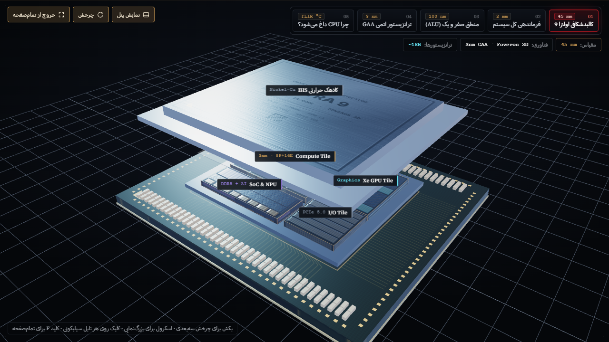
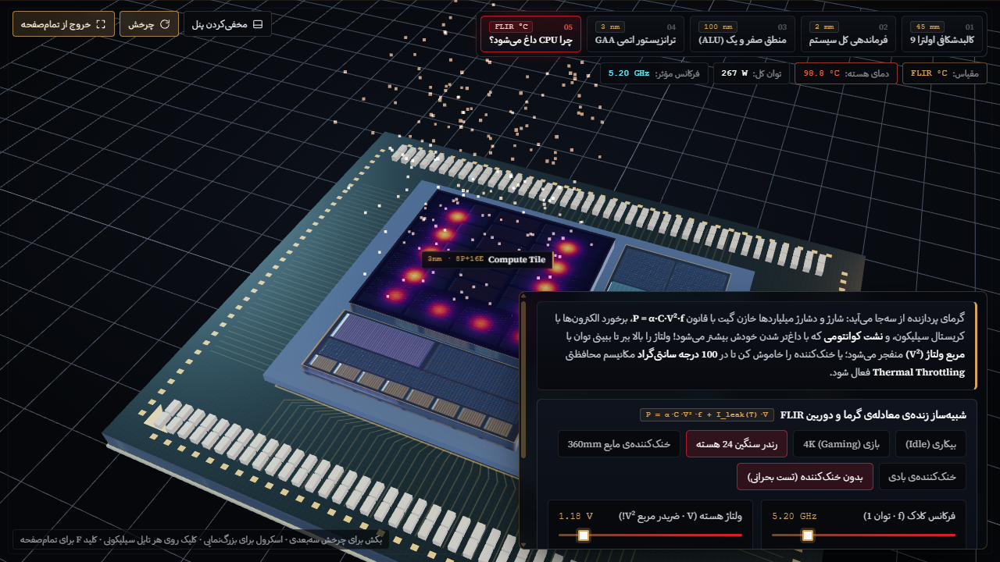

<div align="center">

# Inside a 3nm CPU — Multi-Scale 3D Hardware & FLIR Thermal Lab

**Zoom 15,000,000× inside a flagship 3nm CPU — from an explodable Foveros 3D package down to a 4-bit silicon adder, a 3nm GAA nanosheet transistor with quantum tunneling, and a real-time 48×48 2D Heat PDE FLIR thermal camera.**

[](https://navidixstudio.com/explore/inside-a-cpu/)
[](#run-locally-in-10-seconds)
[](./LICENSE)

*Part of [**Navidix Interactive Science Platform**](https://navidixstudio.com/explore/) · Built solo by [**Mohammad Navidi**](https://github.com/NavidixStudio).*

</div>

---

<table>
  <tr>
    <td width="50%" align="center">
      <a href="https://navidixstudio.com/explore/inside-a-cpu/"></a>
      <br/><b>Scale 01 (45 mm): Explodable 3nm Foveros 3D Package</b>
      <br/><sub>Brushed Nickel-Cu IHS, 160 SMD Caps, 144 Copper TSVs &amp; 4 Clickable Dies</sub>
    </td>
    <td width="50%" align="center">
      <a href="https://navidixstudio.com/explore/inside-a-cpu/?c=thermal"></a>
      <br/><b>Scale 05 (FLIR °C): Live 48×48 2D Heat PDE &amp; PROCHOT</b>
      <br/><sub>Authentic Ironbow FLIR overlay, P = α·C·V²·f + I_leak(T)·V &amp; 100°C Throttling</sub>
    </td>
  </tr>
</table>

---

## Five Physical Scales — 100% Procedural PBR, Zero External 3D Models

Every single texture (brushed titanium-nickel IHS, fiberglass/copper PCB substrate, photolithography silicon die-shots for all 4 chiplets, silkscreened `XOR/AND/OR` logic macros, and the live FLIR heatmap) is **procedurally synthesized in browser Canvas** with `PMREMGenerator` darkroom reflections and `ACESFilmicToneMapping`. Zero `.glb` files. Zero build pipeline.

| Scale | Physical View | Real Interactive Mechanics & Physics |
| :-: | :--- | :--- |
| **01 · `45 mm`** | **3D Chiplet Package (`Foveros 3D`)** | Explode slider (`Delid`), X-Ray IHS toggle, 160 `InstancedMesh` SMD decoupling capacitors, 144 vertical copper TSV pillars, and click-to-inspect HUD on all 4 silicon tiles (`Compute 8P+16E`, `Xe GPU`, `SoC + NPU`, `I/O PCIe 5.0`). |
| **02 · `2 mm`** | **System Orchestration & 5-Stage Pipeline** | Live copper data-bus highways connecting the CPU to Dual-Channel `DDR5 RAM`, `PCIe 5.0 GPU`, `NVMe SSD` & Display/I/O. Switch workloads (`4K Gaming`, `AI Inference`, `Web Browser`) or press **`S`** / `+1 Clock Cycle` to single-step real assembly & binary instructions through `FETCH → DECODE → EXECUTE → MEM → WB`. |
| **03 · `100 nm`** | **Pure 0s & 1s (`4-Bit Ripple-Carry Adder`)** | Real, un-faked Boolean logic evaluator built with laser-etched `XOR`, `AND` & `OR` silicon macros and raised 3D copper traces (`0V` vs `0.85V`). Toggle 8 hardware DIP switches (`A[3:0]`, `B[3:0]`) and watch the ripple-carry wave propagate bit-by-bit into the 5-bit output LEDs. |
| **04 · `3 nm`** | **Atomic GAA / RibbonFET Transistor** | 3 stacked horizontal silicon nanosheet ribbons (~15 silicon atoms wide) wrapped 360° by a cutaway `HfO₂` metal gate, vibrating Si crystal lattice atoms (phonons), and 260 live electrons. Drop `V_GS` below threshold (`0.32 V`) to observe **quantum-tunneling leakage** slipping through the depletion barrier; raise it to see Joule-heating lattice scattering. |
| **05 · `FLIR °C`** | **Why CPUs Generate Heat (`2D Heat PDE`)** | Real-time `48×48` finite-difference 2D heat diffusion solver rendered onto an authentic **Ironbow FLIR** overlay over the 8 P-Cores + 4 E-Core quads. Adjust clock `f`, core voltage `V` (watch power explode with `V²`!), workload, and cooler (`360mm AIO` / `Air` / `None`) to trigger automatic **100°C `PROCHOT` thermal throttling**. |

---

## Run Locally in 10 Seconds

Zero `npm install`, zero webpack, zero backend:

```bash
git clone https://github.com/NavidixStudio/inside-a-3nm-cpu.git
cd inside-a-3nm-cpu
npx serve .
```

Or open the hosted live experience directly: **[`navidixstudio.com/explore/inside-a-cpu/`](https://navidixstudio.com/explore/inside-a-cpu/)**

---

## Keyboard Shortcuts

- **`F`** — Toggle Spatial Fullscreen Observatory
- **`S`** — Single-Step Clock Cycle (in Scale 02 System Orchestration)
- **`Esc`** — Exit Fullscreen or Close Tile Inspector
- **Drag / Scroll / Pinch** — Free 3D Orbit & Zoom · **Click any silicon tile** — Open Engineering Spec HUD

---

<div dir="rtl" align="right">

## معرفی فارسی — درون یک پردازنده‌ی ۳ نانومتری

این پروژه نسخه‌ی متن‌باز و مستقل از آزمایشگاه سه‌بعدی **«درون یک پردازنده‌ی ۳ نانومتری»** در [پلتفرم علمی تعاملی استودیو نویدیکس](https://navidixstudio.com/explore/inside-a-cpu/) است که با **Three.js خالص** (بدون نیاز به هیچ ابزار بیلد یا فایل سه‌بعدی خارجی) ساخته شده است:

- **۵ مقیاس فیزیکی واقعی:** کالبدشکافی پکیج چیپلت سه‌بعدی `Foveros 3D`، فرماندهی هم‌زمان `DDR5 / GPU / NVMe` با خط لوله‌ی ۵ مرحله‌ای، جمع‌کننده‌ی واقعی ۴بیتی صفر و یک، ترانزیستور اتمی `3nm GAA` با تونل‌زنی کوانتومی، و دوربین حرارتی زنده‌ی `FLIR` با حل‌کننده‌ی معادله‌ی پخش گرمای `48×48` و محافظ `PROCHOT`.
- **دموی آنلاین:** [`navidixstudio.com/explore/inside-a-cpu/`](https://navidixstudio.com/explore/inside-a-cpu/)

</div>

---

## License

MIT © 2026 [Mohammad Navidi — Navidix Studio](https://navidixstudio.com)
